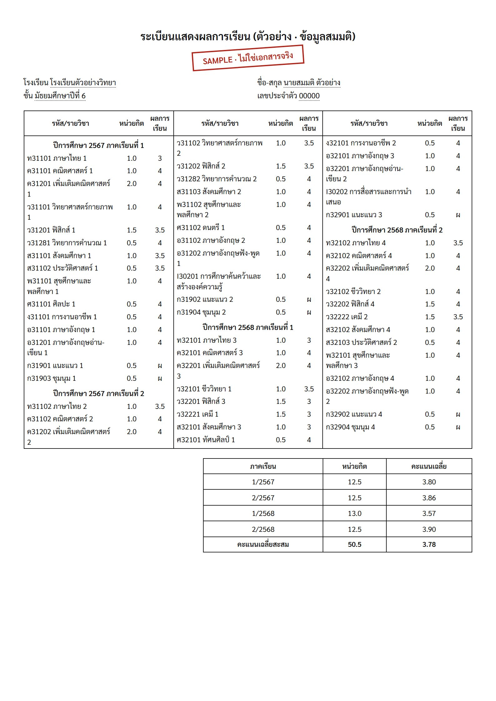

# Transcript GPA AI

**Upload a Thai high-school transcript (ปพ.1) as a PDF or photo. A free AI reads the table, and plain code calculates credits and GPA for every learning area (กลุ่มสาระ) and every semester.**

อัปโหลดใบ ปพ.1 แล้วได้ตาราง หน่วยกิต / เกรดเฉลี่ย แยกตาม 8 กลุ่มสาระและแต่ละภาคเรียน ทันที ใช้ฟรี

**Try it: [transcript.atomengineer.site](https://transcript.atomengineer.site)** (the "ลองกับใบตัวอย่าง" button shows a demo without uploading anything)



## How it works

```
PDF ──pdf.js──▶ page images ──▶ Cloudflare Worker ──▶ Workers AI (Qwen vision model)
                                                          │  copies every row as JSON:
                                                          │  term heading / code, credits, grade
                                                          ▼
                        browser ◀── rows grouped into terms (code, not AI)
                           │
                           ▼  gpa.js (no AI)
          credits & GPA by learning area × term, GPAX,
          checked against the GPA the school printed
```

The design rule is **the AI reads, the code calculates**:

| Step | Done by | Why |
|---|---|---|
| Read the scanned table | AI (vision model) | Scans vary too much for fixed rules |
| Decide which term each row belongs to | Code | Models mix up columns; reading order + headings is reliable |
| Learning area from the course code (ท ค ว ส พ ศ ง อ) | Code | It's a fixed rule |
| Credits, GPA, rounding | Code | Language models make arithmetic mistakes |
| Check the result | Code + you | Compared with the school's printed GPA; odd values are flagged and editable |

### Things I learned building it

- **Asking the AI to group rows by semester failed.** On a real ปพ.1, a semester often continues into the next column. The model put rows under the wrong term and silently skipped a whole semester. Asking it only to copy rows *in reading order* (with semester headings as marker rows) and grouping them in code fixed this: 66 of 66 rows correct on a real transcript.
- **Model choice mattered more than prompt wording.** Llama 4 Scout turned Thai letters into Latin ones (ท → t), and Gemma 4 invented rows. Qwen copied every cell correctly, including two printing errors on the real document.
- **The AI should copy mistakes, not fix them.** The real transcript had "21.0" credits where it meant "1.0" (a stray pen mark). The AI copied it faithfully, `gpa.js` flagged it as "probably 1.0", and the user corrects it in the table.
- **Thai transcripts truncate GPA instead of rounding** (3.6875 → 3.68). The app shows truncated values and accepts either when checking against the school's numbers.
- **Reasoning ("thinking") mode made the model time out** after 2 minutes. Turning it off and streaming the response brought one page to about a minute.
- **Free has a budget.** One page uses about 3,900 input and 2,800 output tokens, roughly 1,000 of the 10,000 free Workers AI "neurons" per day. The worker counts pages per day in Workers KV and stops at 8, and the demo button loads the sample's printed rows (`sample/answer-key.json`) instead of calling the AI.

### Learning-area codes

| Code | กลุ่มสาระ | Course codes starting with |
|---|---|---|
| THA | ภาษาไทย | ท |
| MATH | คณิตศาสตร์ | ค |
| SCI | วิทยาศาสตร์และเทคโนโลยี | ว |
| SOC | สังคมศึกษา ศาสนา และวัฒนธรรม | ส |
| HPE | สุขศึกษาและพลศึกษา | พ |
| ART | ศิลปะ | ศ |
| WORK | การงานอาชีพและเทคโนโลยี | ง |
| FL | ภาษาต่างประเทศ | อ จ ญ ฝ ย ร ล ข |
| IS | การศึกษาค้นคว้าด้วยตนเอง | I |

English Program transcripts are supported too: course codes like `THA31101`, `MATH31207`, `WORK ED31101`, `ENG30201`, and yearly headings like "First Year (2024)". Tested on a real English transcript: 66 of 66 courses read correctly and the GPA matched the school's 3.43.

Activities (ก) and pass/fail, audit or incomplete grades (ผ มผ ร มส, S U I A UE) are not counted in GPA.

## Privacy

- Files go to Cloudflare Workers AI only to be read. Nothing is stored, and Cloudflare does not train models on Workers AI inputs.
- The AI is told to skip names, ID numbers and addresses; only course code, credits and grade come back.
- All calculation happens in your browser.

## Run it yourself

Needs [Node.js](https://nodejs.org) and a free [Cloudflare](https://dash.cloudflare.com/sign-up) account. Before deploying, create your own KV namespace (`npx wrangler kv namespace create USAGE`), put its id in `wrangler.jsonc`, and change or remove the `routes` custom domain.

```bash
git clone https://github.com/rawichsripian-art/transcript-gpa-ai
cd transcript-gpa-ai
npm test                 # unit tests for the GPA maths (no AI, no network)
npx wrangler dev         # local server at http://localhost:8787 (the AI call runs on Cloudflare)
npx wrangler deploy      # publish to your own workers.dev address
```

Rebuild the made-up sample transcript (Windows, uses Edge):

```bash
node tools/make-sample.mjs
powershell -File tools/render-sample.ps1
```

## Files

| Path | What it does |
|---|---|
| `src/worker.js` | API: validates uploads, asks the AI to transcribe rows, groups them into terms |
| `public/gpa.js` | All the maths: learning areas, grade points, GPA, warnings, checks. Shared by browser, worker and tests |
| `public/app.js` | Browser: PDF → images (pdf.js), calls the API, shows and edits results, CSV export |
| `test/gpa.test.js` | Unit tests on a made-up transcript with hand-checked answers |
| `tools/` | Generates the made-up sample transcript |

## Limits

- Up to 4 pages per file and about 8 pages per day for everyone together (free quota). Clear scans work best.
- Reading one page takes about a minute.
- Made for the Thai basic-education curriculum (ปพ.1). Other formats may need prompt changes.
- Always check the result against your real transcript before using it for an application.

## License

MIT · made by [Rawich Sripian](https://atomengineer.site)


## Usage log and remaining quota

- `GET /api/quota` (public) shows how many pages are left today per account and when the counter resets (00:00 UTC = 07:00 Thailand). Each `/api/extract` response also carries the remaining total.
- Every request writes one line to the `USAGE` KV for 30 days: time, country, a short one-way visitor fingerprint, outcome (`ok` / `quota` / `rate_limited` / `bad_request` / `error`), pages, account used, time taken and AI tokens. It never stores the transcript, the raw IP or any names. Daily totals are kept under `stats:YYYY-MM-DD`.
- `GET /api/usage?days=7` returns the totals and the last 50 lines. It stays off until you set a secret with `wrangler secret put ADMIN_TOKEN`; then call it with `Authorization: Bearer <token>`. Optionally set `LOG_SALT` the same way so the visitor fingerprint can't be guessed.
- The counters are this worker's own soft caps. Cloudflare's real free allowance can run out sooner if the same account does other AI work.
